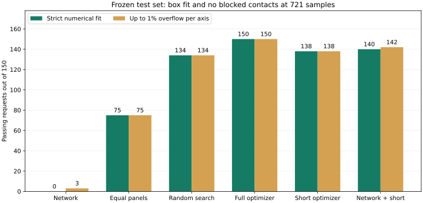
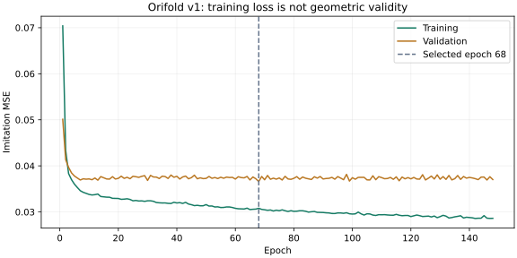

# First learning experiment: completed, performance target not met

> **Audit note (added 2026-11-04, after the run).** A later check found the training labels inconsistent: re-solving with another seed usually gives a different valid design. The failure analysis below was written before that check and misses its main cause. See [DECISIONS.md D10](DECISIONS.md). The measured results here are unchanged.

Orifold now has a neural network trained from random initialization, a frozen dataset/split manifest, a saved checkpoint, and held-out evaluation. **This first network is not a usable standalone design generator:** it passed 0/150 strict-fit requests and only 3/150 with a 1% per-axis allowance. The conventional optimizer remains the reliable method in this experiment.

## What was built and checked

- Independent standard-library Python geometry port in `learning/geometry.py`. Eight named fixtures and 32 seeded random designs agree with the original Node reference on geometry, contacts, and sampled fit. Model decoding also matches the Node parameterization, and its gradients were checked numerically.
- 1,000 new evaluator-feasible requests, balanced across the existing wide-box and narrow/tall cohorts: 700 train, 150 validation, 150 test. An additional 100 impossible-width cases are separate diagnostics, never design labels.
- Splits frozen before optimization; normalized request fingerprints prevent duplicates/scaled variants across splits and overlap with the earlier pilot. No data augmentation was applied. All 1,000 label searches succeeded and were strictly revalidated. Failures would have remained recorded rather than being replaced.
- A CPU-only PyTorch MLP: 4 dimensionless inputs → 128 tanh units → 128 tanh units → 6 sigmoid outputs, **17,926 trainable parameters**. Six bounded parameters decode to positive panel lengths summing to sheet length and three angle magnitudes. No pretrained model or learned weights were imported.
- Inputs are sheet width and the three box dimensions divided by sheet length, then standardized using training data only. Loss is mean squared error over four normalized panel lengths and three normalized angles. It is supervised imitation, not a complete physics loss or a GAN.

Training used AdamW, learning rate 0.001, weight decay 0.0001, batch size 64, one CPU thread, and seed 161803. The rule fixed before training was a maximum of 600 epochs, early stopping after 80 epochs without improved validation MSE, and selection by lowest validation MSE. It stopped after 148 epochs and selected epoch 68 (validation MSE 0.036605). The test set was first evaluated after this checkpoint was frozen. No post-test model tuning was performed.

## Frozen test results

All geometric acceptance uses the original Node reference at 721 motion states. The test cohort has 75 wide-box and 75 narrow/tall requests, independently generated from the same distribution as training.

| Method | Strict fit and sampled contacts | Up to 1% overflow per axis | Median checked latency |
| --- | --- | --- | --- |
| Network only | **0/150** | **3/150** | 2.36 ms |
| Equal-panel flat stack | 75/150 | 75/150 | 2.48 ms |
| Random search, 984 candidates | 134/150 | 134/150 | 127.98 ms |
| Full optimizer, 984 candidates | 150/150 | 150/150 | 128.73 ms |
| Short optimizer, 264 candidates | 138/150 | 138/150 | 49.09 ms |
| Network-initialized short optimizer, 264 candidates | 140/150 | 142/150 | 49.32 ms |

Raw warm network inference, including feature conversion and design decoding but excluding geometric checks and checkpoint load, was about **0.030 ms** median. Fast invalid proposals are not a useful speedup. Checked latency includes validation; hybrid latency includes inference and search. Timings are sample measurements, not guarantees; the reported medians use the upper-middle observation for even-sized Node timing cohorts.

The paired short-search comparison holds the seed, random draws, canonical seeds, and budget fixed; the network replaces only one random initial population member. It wins on 6 requests the cold short search misses and loses on 4 the cold search solves, a net gain of 2 strict successes. This small single-seed result does **not** establish a reliable learned advantage. Two additional returned hybrid candidates pass at 1% but not strictly; they are not strict solver successes.

All 100 impossible-width diagnostics are rejected by the explicit width invariant. This is not a learned feasibility classifier. The experiment does not test out-of-distribution geometry, new crease families, thickness, or continuous collision certification.



## Failure analysis

The network's 150 proposals had no blocked contacts at the sampled states, but 147 exceeded at least one box dimension by more than 1%. Median worst-axis overflow was **33.84%**. For one wide-box example, a permitted height of 7.70 cm became 15.61 cm; for one narrow example, a permitted length of 9.54 cm became 12.01 cm. The output bounds guarantee legal parameter ranges, not target fit.

The loss improved while the design acceptance remained poor. *Post-run audit:* the labels themselves are inconsistent (D10), which makes averaging the expected outcome rather than one possible contributor. Original analysis: squared imitation error rewards averages of different valid design choices; such averages need not satisfy nonlinear geometric constraints. This is a plausible contributor, not a proved sole cause. The first training run has no direct penalty for exceeding the requested box and no geometric validation criterion for checkpoint selection. These are concrete limitations to investigate before increasing model size.



Keep this failed baseline intact. The next step is to agree an experiment specification before any new training (DECISIONS.md D11). Hard contact checks must remain independent. Predeclare the next configuration and a fresh held-out cohort, rather than tuning to these revealed test results. More complex architectures, more data, or a different folding family are not yet justified by this result.

## Time, environment and artifacts

Measured CPU time in this environment:

- Dataset generation and strict label checks: **133.52 seconds**.
- Training loop: **1.62 seconds**, excluding interpreter/import/setup overhead.
- Six-method held-out comparison: **55.63 seconds**.

CPU-only PyTorch 2.9.1+cpu, NumPy 2.3.5, Python 3.12.14; model used one thread. The project venv reused existing system-site packages and installed CPU PyTorch locally. No GPU or additional paid compute was provisioned. Actual versions are saved in `run/environment.json`; the setup below describes a clean environment.

All artifacts are under [experiments/learning-v1](../experiments/learning-v1):

| Artifact | Purpose |
| --- | --- |
| `config.json`, `manifest.json` | Predeclared experiment and request/split assignments |
| `dataset.jsonl.gz`, `dataset-summary.json` | Requests, withheld witnesses, labels, solver outcomes and integrity hashes |
| `run/checkpoint.pt` | Selected model parameters and training-only input normalization |
| `run/history.csv`, `run/training-summary.json` | Loss curves, stopping decision, versions, runtime and seed |
| `run/test-predictions.json` | Frozen network outputs and inference timing |
| `run/test-evaluation.jsonl.gz`, `run/evaluation-summary.json` | Per-request baseline outcomes, metrics and failure examples |

Checkpoints are loaded with `weights_only=True`. Gzipped artifacts are standard JSON Lines; read them with Python `gzip.open`. Split generation and model/solver seeds are fixed; timestamps, timing values and therefore some artifact hashes change on reproduction. Exact weights can also vary across hardware/library versions, so preserve the recorded artifacts as evidence.

## Reproduce or inspect

From the repository root:

```sh
python3 -m venv .venv
.venv/bin/python -m pip install torch==2.9.1 --index-url https://download.pytorch.org/whl/cpu
.venv/bin/python -m pip install -r requirements-learning.txt
npm test
.venv/bin/python -m unittest discover -s tests -p 'test_*.py' -v
.venv/bin/python -m learning.predict --request examples/narrow-box.json
```

Inference returns a proposal, not an accepted design. For an exact workflow reproduction without overwriting saved results:

```sh
mkdir -p artifacts/learning-reproduction
cp experiments/learning-v1/config.json artifacts/learning-reproduction/config.json
node scripts/generate-learning-data.js artifacts/learning-reproduction artifacts/learning-reproduction/config.json
.venv/bin/python -m learning.train --experiment artifacts/learning-reproduction
.venv/bin/python -m learning.predict --experiment artifacts/learning-reproduction
node scripts/evaluate-learning.js artifacts/learning-reproduction
```

Each generator/training/evaluation command refuses to overwrite its completed artifacts. Review failures and use a new output directory for a deliberate new run. The original Node geometry remains authoritative for reported acceptance; Python parity is a guard against divergence, not permission to silently change the model's assumptions.
