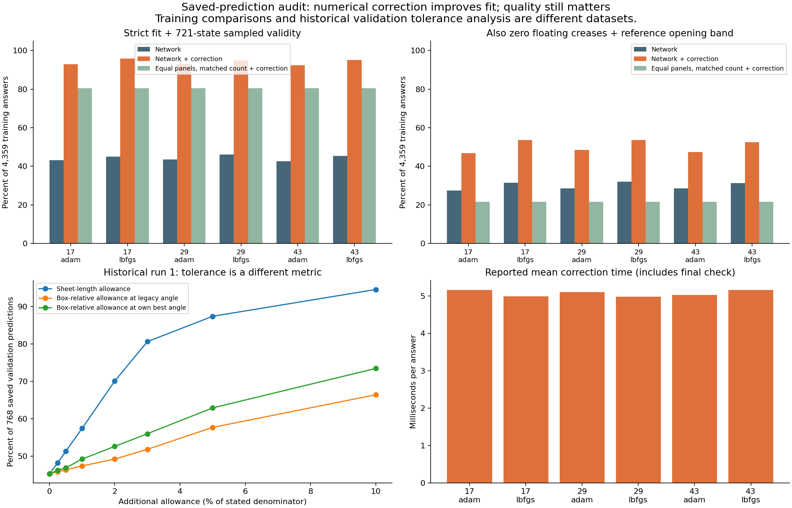

# Claude tolerance and correction audit

Claude’s saved run-1 correction success count is confirmed: **720/768 (93.75%)** remain valid under the underlying evaluator at their recorded corrected poses. Applying the same unchanged correction to our new training predictions raises mean validity to **92.85% (Adam)** and **95.35% (Adam + L-BFGS)**. These are hybrid numerical-search results, not neural-only precision. Training and historical validation percentages must not be compared as evidence of better generalization.

Protocol/code frozen in `60d1b9e` before applying the unchanged legacy correction to new saved training predictions. No retraining, new validation model inference, or final-test evaluation. All original results remain unchanged.

## New training predictions, all three seeds and both recipes

| Model | Original valid | Legacy corrected flag | Evaluator-confirmed corrected | Also walls + opening | Matched-count equal-panel control valid | Control walls + opening |
| --- | ---: | ---: | ---: | ---: | ---: | ---: |
| seed-17-adam | 1884/4359 | 4045/4359 | 4052/4359 (92.96%) | 2045/4359 | 3508/4359 | 946/4359 |
| seed-17-lbfgs | 1959/4359 | 4170/4359 | 4177/4359 (95.82%) | 2334/4359 | 3508/4359 | 946/4359 |
| seed-29-adam | 1895/4359 | 4054/4359 | 4060/4359 (93.14%) | 2114/4359 | 3508/4359 | 946/4359 |
| seed-29-lbfgs | 2010/4359 | 4138/4359 | 4142/4359 (95.02%) | 2334/4359 | 3508/4359 | 946/4359 |
| seed-43-adam | 1861/4359 | 4029/4359 | 4030/4359 (92.45%) | 2067/4359 | 3509/4359 | 946/4359 |
| seed-43-lbfgs | 1976/4359 | 4144/4359 | 4150/4359 (95.21%) | 2290/4359 | 3508/4359 | 946/4359 |

Counts use unchanged 2% box margin and 721 motion states, plus fold-budget checks. The raw legacy flags and canonical final-pose assessments are both retained. The evaluator rechecks the saved pose without another placement search.

## Means over three training seeds

adam: corrected mean validity 92.85%, valid+walls+opening 47.61%, correction 5.09 ms/answer, mean 25.04 score calls.
lbfgs: corrected mean validity 95.35%, valid+walls+opening 53.21%, correction 5.04 ms/answer, mean 18.17 score calls.

The matched-count control uses the model-provided fold count but replaces continuous values with equal panels and 150-degree angles. It isolates the usefulness of those continuous values, not a fully model-free pipeline. Identical controls are computed once across models/seeds; report denominators still refer to each model group. This is descriptive development evidence, not held-out proof that learning beats conventional search.

## Historical Claude run-1 correction, existing validation records only

model: original saved flags 720/768; final-pose evaluator confirms 720/768; zero floating among passing 552; valid+walls+reference-opening-band 311; maximum evaluations 401, over nominal 400: 1.
dumb-start: original saved flags 591/768; final-pose evaluator confirms 593/768; zero floating among passing 326; valid+walls+reference-opening-band 47; maximum evaluations 416, over nominal 400: 20.

Canonical reassessment invokes the same underlying evaluator; it is not an independent collision proof. Correction process wall time and reported per-answer times include numerical placement/final checking, exclude neural inference. Separate audit reassessment time is not part of deployment correction. Timing is environment-specific.

Raw corrected designs, evaluation calls, timing, flags and full final assessments are retained in [results](results/). Source and input hashes are recorded; original scripts/data were not modified. No run or seed was dropped.

## Was the tolerance calculation correct?

The revised tool is useful as an **analysis of extra final-box allowance**, with limits. It does not relax the panel/angle rules or measure agreement with reference lengths/angles. Rule validity and 721-state contacts remain required. It preserves 98% usable box dimensions and then asks how much additional overshoot would be needed. This changes the hypothetical fit criterion; it does not make a design pass the original specification.

The original curves used `P.overflowOf`, which could report an arbitrary non-fitting orientation; that was already corrected in the November 6 revision. Independent side-view recomputation here reproduces all revised run-1 sheet-normalized counts at the saved thresholds (348/768 at zero, 441/768 at 1%, 671/768 at 5%, 726/768 at 10%). It is a finite sweep with local refinement and gives upper bounds on minimum overflow, not a global optimization or continuous-motion proof.

Three remaining caveats:

1. **Denominator matters.** Sheet-relative tolerance can be very large relative to a small box. With L=100 and a usable side of 10, 5% L allows 5 extra units, or 50% of that side. The published 87.4% pass at 5% L should never be paraphrased as 87.4% pass within 5% of box dimensions.
2. **Box-relative column uses the wrong placement objective.** It chooses the orientation minimizing absolute overshoot divided by L, then measures relative overshoot at that angle. Minimizing relative overshoot per usable axis requires its own search. Thus the legacy relative column can understate attainable relative-tolerance success.
3. **Width is omitted from the box-relative column.** The sheet-relative column includes width. A reproducible width-infeasible fixture (`v2-widthImpossible-0000`) has width 18.2640 against usable width 10.9631, yet the box-relative column reports 100% pass at zero allowance. Panel rules do not detect task-width infeasibility. This bug does not affect run 1 because its predicted requests are width-feasible.

Historical run-1 results, percentage of 768 saved predictions:

| Additional allowance | Sheet length | Legacy box-relative column | Box-relative own placement objective |
| --- | ---: | ---: | ---: |
| 0% | 45.3% | 45.3% | 45.3% |
| 1% | 57.4% | 47.4% | 49.2% |
| 5% | 87.4% | 57.7% | 62.9% |
| 10% | 94.5% | 66.4% | 73.4% |

Box-relative means relative to **usable dimensions (0.98 × physical box)**. For example, an added 5% of usable side permits 1.05×0.98 = 1.029 times the physical side, potentially protruding by 2.9%. The objective comparison isolates geometry metrics; it relies on existing run-1 rule/contact evidence and does not claim a new independent motion audit. [Detailed objective records](tolerance-audit/run1-metric-objectives.json), [width fixture output](tolerance-audit/width-fixture-output.txt), [reproduction script](../../scripts/audit-tolerance-metrics.py).

These issues call for correction before using the tool generally; they do not invalidate the revised sheet-relative diagnostic on run 1. All old files are retained unchanged.

## Was Claude’s run-1 correction legitimate?

Yes, as a separately reported **model plus numerical search** development method. The legacy algorithm fixes the predicted fold count, searches all panel lengths and angles using a free family, then seeks wall placement and assesses the result at 721 states. A nominal budget of 400 search scores limits effort, not geometric edit size. It targets fit and contacts rather than closeness to the reference or optimal ranking.

Caveats retained in this audit:

- Search contact screening uses only 31 states; the final evaluator uses 721. Final passing checks therefore retain the original sampling policy, but the coarse search screen may miss paths that later fail.
- The loop can overrun its nominal score budget because it checks the limit outside its coordinate loop and counts the initial score too. Historical model correction has one 401-score case; the old budget-count control reaches 416. Our new attempts reach 441. It should not be described as a strict maximum of 400 evaluations.
- It starts shape repair only for a positive `overflowOf` result and two or more panels. A fitting-but-colliding design is not explicitly repaired. Its overflow objective also inherits the known orientation limitations. Final checks still reject invalid outputs; these restrictions affect search quality and missed opportunities.
- The final positive-overflow prefilter predates our tolerance-consistency fix. Canonical reassessment accepts 31 additional new-model outputs and one matched-control output that the raw correction flags reject. Both flag sets are retained. Claude’s 720 run-1 model successes all confirm; its historical budget-count control changes from 591 to 593 under canonical reassessment.
- Successful validity does not imply wall/opening quality. Of Claude’s 768 corrected model records, 720 are valid, 552 are valid with zero floating creases, and only **311 (40.5%)** also retain at least 90% reference opening.
- Claude’s unlearned baseline used fold count equal to budget, whereas the neural method supplied its own predicted count. This combines the value of learned count with learned geometry. Our matched-count control removes that particular difference, but still depends on the model’s count and is not an entirely model-free pipeline.

Correction edit sizes are measured separately in [shape-edit-sizes.json](results/shape-edit-sizes.json). Across all attempted L-BFGS corrections, the 90th percentile of the maximum panel-length change per answer is about **5.4% L**, and the 90th percentile of the maximum angle change is **7.16 degrees**. Some edits are much larger. Thus higher corrected pass rates are not evidence that original panel/angle predictions were already within tiny tolerances. The method is a bounded-effort solver initialized by the network.

## What our new correction results establish

A matched-count, equal-panel/150-degree control with the identical correction reaches about **80.5%** training validity and **21.7%** valid+walls+opening. Learned continuous geometry improves the initialization: corrected Adam/L-BFGS reach **92.85%/95.35%** validity and **47.61%/53.21%** quality, respectively. The same seed/request comparison supports a useful role for learned geometry in this hybrid on training data. It does not prove superiority to a fully model-free solver that enumerates counts or uses a different initialization/search, nor does it establish unfamiliar-box performance.

Reported correction time is about **5 ms per answer** here, averaging about 25 score calls for Adam and 18 for L-BFGS. This includes the method’s final placement/assessment; it excludes neural inference and our separate audit reassessment. The control averages about 3.64 ms but has more failures and less opening; fewer score calls do not necessarily imply lower elapsed time across these different trajectories. No timing comparison with historical machines is justified.

Recommendation: report both neural-only and neural-plus-correction methods. Fix tolerance width/objective handling and exact budget enforcement in a new version before a frozen validation benchmark. Keep the original margin and contact rules for the main pass metric; tolerance curves remain diagnostics. Include a competitive model-free baseline and report validity, wall/opening quality, edit magnitude and total time. Final test stays untouched.

Validation: **25 Python tests passed**, including audit summary behavior and existing geometry/gradient tests. No original search, solver or tolerance script was changed; Node tests were not rerun for read-only audit helpers. Source/input hashes verified, raw correction flags retained, historical files untouched. No `src/packing.js` source was read. All jobs finished. These are sampled zero-thickness results, not ranking optimality, continuous collision-free motion, or physical certification.

## Panel/angle precision reporting is a separate calculation

`precision-report.py` reports signed-error bias and pooled error scatter for predictions with the same fold count as the reference, excluding zero-fold cases. It does not apply acceptance tolerances to lengths or angles. Its scatter is the standard deviation of errors across different designs/parameters, not repeatability on the same box across training seeds. Both are useful, different measurements.

Panel-length bias pooled this way is mathematically constrained to approximately zero: each predicted design and reference sum to the same sheet length, so positive and negative panel errors cancel within every example. It cannot establish accurate panel placement. Use absolute errors or RMS, high percentiles and per-design maxima, alongside signed angle bias, and always disclose the matching-count denominator. Unequal fold counts give different numbers of terms in the pooled statistics. The spec’s 1%-of-L length and 1-degree angle thresholds define symmetry/order grouping; they are not model-prediction error allowances.
