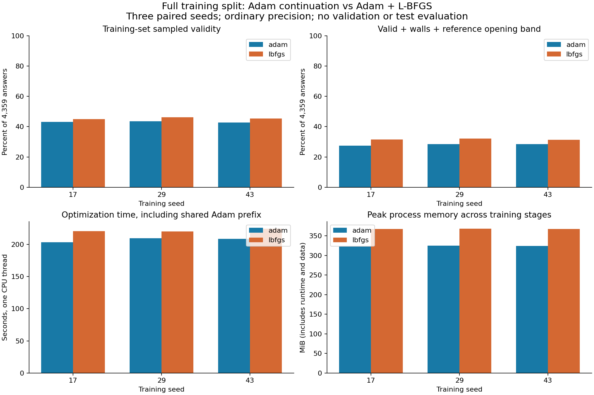

# Full-training recipe comparison

**L-BFGS gives a small, consistent training improvement, but the full-data model is still unreliable.** Mean training sampled validity is **43.13%** with Adam and **45.46%** with Adam + L-BFGS. Every seed favors refinement, yet more than half of training answers still fail strict box fit.

Step 3 is complete. These are training-set measurements only; no validation/test predictions or method selection have been performed. Protocol, config and manifest were committed in `3f212ef` before execution.

The same 4,359 training answers from 1,453 requests, corrected generic MLP, parameter loss and float32 precision were used throughout. Each paired seed shares its entire Adam prefix; only the final refinement method differs. Both branch optimizers start with fresh state. No seed, checkpoint or iteration was chosen by its geometric score.

| Seed | Stage | Valid /4,359 | Valid + walls + opening | Correct count | Precision gate | Optimization seconds | Peak process MiB |
| --- | --- | ---: | ---: | ---: | ---: | ---: | ---: |
| 17 | prefix | 1831 (42.01%) | 1139 | 4340 | 783 | 106.8 | 310.0 |
| 17 | adam | 1884 (43.22%) | 1197 | 4355 | 783 | 203.5 | 323.0 |
| 17 | lbfgs | 1959 (44.94%) | 1376 | 4359 | 785 | 220.5 | 367.5 |
| 29 | prefix | 1828 (41.94%) | 1140 | 4339 | 783 | 107.0 | 309.9 |
| 29 | adam | 1895 (43.47%) | 1242 | 4355 | 786 | 209.5 | 324.9 |
| 29 | lbfgs | 2010 (46.11%) | 1399 | 4359 | 783 | 220.2 | 368.0 |
| 43 | prefix | 1832 (42.03%) | 1170 | 4340 | 785 | 106.7 | 309.4 |
| 43 | adam | 1861 (42.69%) | 1242 | 4354 | 783 | 208.3 | 324.4 |
| 43 | lbfgs | 1976 (45.33%) | 1366 | 4359 | 785 | 224.2 | 367.3 |

## Paired summary

adam: mean sampled validity **43.13%**, seed range 42.69–43.47%.
lbfgs: mean sampled validity **45.46%**, seed range 44.94–46.11%.
L-BFGS minus Adam: paired validity differences +1.72, +2.64, +2.64 percentage points; mean +2.33. Three seeds do not establish statistical significance or a general optimizer ranking.

Descriptive post-hoc breakdown by reference fold count (pooled over all three seeds; repeated predictions are not new independent requests):

| Reference folds | Adam valid | L-BFGS valid |
| --- | ---: | ---: |
| 0 | 2349/2349 (100.00%) | 2349/2349 (100.00%) |
| 1 | 1286/3048 (42.19%) | 1354/3048 (44.42%) |
| 2-3 | 1697/6219 (27.29%) | 1862/6219 (29.94%) |
| 4+ | 308/1461 (21.08%) | 380/1461 (26.01%) |

## Measurement definitions and limitations

Both recipes include the same 1,500-epoch minibatch Adam prefix. Branches have nominally 2,000 full-batch objective-evaluation budgets. Actual iteration/evaluation counts, final gradients, stopping flags and training histories are saved. L-BFGS can return early or slightly exceed its ceiling to finish a line search; numerical convergence must not be inferred from a library return. Equal evaluation ceilings do not imply equal runtime.

Memory is Linux process high-water RSS from fresh worker processes, including interpreter, tensors, network and optimizer, measured before assessment. Recipe peak is the maximum prefix/branch peak, not the sum; stages do not coexist. The child Node evaluator is excluded. This is not optimizer-only or deployment memory. Optimization time includes the shared prefix for each recipe; geometric assessment time is recorded separately.

The corrected reference bridge searches placement and checks 721 motion states. Training validity is not an independent collision reimplementation. Returned-pose overflow is not optimal-placement overflow. No shape correction was applied. Width-infeasible and unresolved requests do not have solved-answer labels and are outside this fitting assessment; the exact train-example manifest is retained.

Joint copying precision requires the decoded fold count to match, vertex RMS <=0.1% L and angle MAE <=0.1 degrees. Error averages in raw summaries only include matching counts and report that denominator. Fold-count mismatch is a failure of the joint copying gate even if the alternate design is valid. Wall/opening counts require a valid design, zero floating creases and opening >=90% of the reference. This does not assess ranking optimality.

These results describe fitting known training examples. They do not establish performance on unfamiliar boxes, superiority to a solver, neural-only end-to-end latency, continuous collision freedom, finite-thickness feasibility or manufacturing usefulness. The frozen validation comparison is the next decision; final test remains untouched.

## Evidence

All three seeds and both recipes, shared-prefix baselines, initial weights, checkpoints, histories, per-answer gzip JSONL records, time/memory summaries and environment are retained in [results](results/). Manifest/checkpoint hashes confirm paired branches share the same start. No historical dataset or result was modified.

Python regression suite passed before training, including training-split exclusion and seeded prefix repeatability. No geometry/solver code changed. All jobs are finished.

## Interpretation

Across seeds, valid designs that also meet wall contact and the reference opening band increase from **28.15% to 31.67%**. Mean total optimization time per recipe is **207.1 s for Adam versus 221.6 s for Adam + L-BFGS**, including the shared prefix (about 7% extra). Mean peak process RSS is **324.1 versus 367.6 MiB** (about 13% extra). These costs are modest for this small model; they do not forecast giant-model training costs. [Aggregate metrics](results/recipe-summary.json).

All six final networks pass the bridge's rule and sampled-contact checks on all training answers. Every failure is box fit. L-BFGS gets the reference fold count correct on **4,359/4,359** for every seed; Adam gets 4,354–4,355 correct. The main observed weakness is continuous geometry, rather than selecting the number of folds. These checks invoke the reference evaluator; they are not independent collision proofs.

The strict copying gate is passed almost entirely by the 783 zero-fold answers: among folded answers, Adam passes 0/3/0 and L-BFGS 2/0/2 across seeds 17/29/43. Validity does not require copying the chosen reference exactly, so this gate is diagnostic rather than an acceptance requirement. Nevertheless, mean vertex error is still about 2.2% L with L-BFGS (versus about 3.7% L among Adam's matching-count predictions), and mean fold-angle MAE is about 1.5 degrees versus 2.3. More training examples expose a harder geometry-learning problem than the earlier restricted 32-example task. This experiment does not isolate why.

All six branches used exactly 2,000 objective evaluations; no L-BFGS branch reached its requested 1e-12 gradient tolerance. The prefix used 52,500 minibatch updates per seed. These are fixed-budget results, not established numerical optima or evidence that the architecture cannot fit better. Prefix cost is counted in each recipe but was physically executed once per seed; do not double-count it when describing experiment compute.

The next decision is a predeclared validation benchmark against conventional methods and a bounded model-plus-correction method. That will test usefulness on unfamiliar boxes. No method or best seed has been selected for final test. Improving the optimizer alone has not made the current recipe reliable.

Verification: **23 Python tests passed** before execution, including training-split exclusion and seeded prefix repeatability. All **39,231** prefix/final training predictions were checked against the frozen manifest; paired branch start hashes match the prefix checkpoint and dataset hash is unchanged. Plot inspected. Historical source/results were not overwritten. `src/packing.js` source was not read. No geometry or solver change was made, so Node tests were not rerun.
