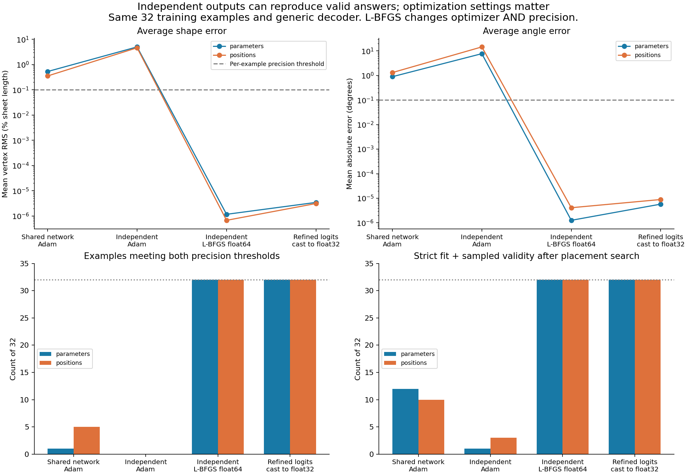

# Independent optimization reaches valid answers for all 32 requests

Both imitation losses recovered all **32/32** reference answers to the predeclared precision target after separate float64 L-BFGS refinement. Every refined answer fits with the unchanged 2% margin after placement search, has zero floating creases, retains at least 90% of reference opening, and passes contact checks at 721 motion states. Casting the refined output logits to float32 preserves **32/32** passes for both losses.

The existing generic output format and either loss can therefore reach suitable answers individually on this subset. No built-in family shape, symmetry constraint, altered rule or geometric repair was needed. This is fitting known reference answers, not a predictor for new boxes.

## What was run

The [protocol](README.md), [config](config.json), runner and tests were committed in **`5c17779` before optimization**. The exact prior 32-example manifest and untrained-network checkpoint are pinned by hashes. Each example gets its own 12 fold logits and 22 shape logits, initialized to exactly the earlier untrained network's outputs. The network is discarded. Both arms retain the original decoder and losses; box features are not used to map between requests.

Stage 1 used the same float32 Adam schedule as memorization-v1: 4,000 steps, learning rate 0.001 then 0.0001 halfway through. Stage 2 optimized each example separately from those final outputs using float64 L-BFGS, with freshly encoded float64 labels. Stage 3 cast the resulting logits to float32 before sigmoid/decoding, without further optimization. Both arms completed every stage. No checkpoint was selected by geometry scores, no restart was tried, and no validation/test example was used.

## Complete results

Counts below are out of 32. The copying gate requires vertex RMS ≤0.1% of sheet length and angle MAE ≤0.1° for **every** example. Primary sampled validity includes box fit after the standard placement search.

| Stage | Copying gate: parameters / positions | Sampled validity: parameters / positions | Valid + walls + opening band: parameters / positions |
| --- | ---: | ---: | ---: |
| Earlier shared network, Adam | 1 / 5 | 12 / 10 | 10 / 9 |
| Independent outputs, same Adam schedule | 0 / 0 | 1 / 3 | 1 / 1 |
| Independent outputs, float64 L-BFGS refinement | **32 / 32** | **32 / 32** | **32 / 32** |
| Refined logits cast to float32 | **32 / 32** | **32 / 32** | **32 / 32** |

All 192 outputs across the six new groups have the correct two-fold count, pass panel/angle rules and have no prohibited sampled contacts. All independent/reference overall validity decisions agree: **0 disagreements in 192 comparisons**. Initial Adam failures were box-fit failures. Zero-floating counts, including failed outputs, were 5/32 and 6/32 for Adam and 32/32 for all refined/cast groups.

| Stage | Mean vertex RMS / L: parameters / positions | Mean angle MAE, degrees: parameters / positions |
| --- | ---: | ---: |
| Independent Adam | 0.04995 / 0.04618 | 7.711 / 14.541 |
| Float64 refinement | 1.17e−8 / 6.75e−9 | 1.26e−6 / 4.11e−6 |
| Refined logits cast to float32 | 3.46e−8 / 3.13e−8 | 5.76e−6 / 8.88e−6 |

L is sheet length. These are means of per-example errors; all individual measurements are retained. The worst refined position-loss example has vertex RMS 1.45e−7 L and angle MAE 0.000125°, comfortably inside the copying gate. Thus the result is not driven by an average hiding poorly copied examples.

Optimization time on one CPU thread, excluding placement and sampled checking: parameter Adam **1.53 s**, parameter refinement **10.11 s**, position Adam **10.50 s**, position refinement **37.49 s**. L-BFGS used 109–823 iterations per request for parameter loss and 120–783 for position loss. Three parameter-loss requests and four position-loss requests reached the evaluation limit. PyTorch finished the ongoing line search, making four of those calls use 1,251 evaluations against the configured limit of 1,250. All final outputs are retained. Do not describe every run as converged to the configured gradient tolerance: largest final gradients were 9.15e−9 and 3.27e−8, versus the requested 1e−12. Geometric success and numerical convergence are separate measurements.

## Placement and precision still matter

Using the *saved reference placement and offset*, rather than re-searching placement, the refined parameter/position outputs pass **29/32 and 31/32**; after casting both pass **29/32**. Placement search recovers all failures without changing panel lengths or angles. Very small residual errors can therefore invalidate a nearly tight saved pose, even when the shape is recoverably valid.

The predeclared 0.01° rotation sweep is reported separately. It misses the narrow fitting orientation for `v2-short-0123-b2` in every refined group: the grid's best overflow is about 2.96e−5 L even though the reference placement search supplies a checked fitting pose. This is direct evidence that finite rotation-grid failures are not proof of infeasibility. Do not substitute sweep counts for the primary validity counts. Raw failed-search fallback-pose overflow is also kept separate from the sweep upper bound.

## What this establishes, and the next question

**Measured:** independent optimization can reach suitable answers for both losses with the existing representation. The strict geometry rules and ordinary float32 output precision do not force failure on these 32 examples. The failed 4,000-step Adam control shows that simply removing shared network weights is not sufficient under that schedule.

**Not isolated:** L-BFGS refinement changed optimizer, numerical precision and optimization budget together. Casting successful outputs to float32 tests storage/decoding, not whether float32 training would follow the same successful path. The experiment does not prove that network capacity, interference, label ambiguity or any single mechanism caused the earlier network failures. Identical learning rates also do not produce identical output changes when optimizing raw logits versus network weights.

**Recommended next, not run:** keep the same generic network and 32 examples, and predeclare an optimizer/precision comparison with convergence measurements. This tests whether the successful output-level optimization can transfer to training a shared mapping, before changing architecture or adding more data. The family-specific output proposal remains outside the approved experiment.

These are zero-thickness, sampled validity results, not continuous collision-free motion, ranking optimality, generalization or physical certification. All jobs are finished.

## Verification and evidence

All **16 Python tests** passed, including independent-versus-batched loss/gradient equivalence, exact initialization parity, recovery of synthetic interior targets for both losses, and rotated-box diagnostics. Existing geometry, gradient and independent FOLD-export parity tests also passed in that suite. No solver/geometry implementation changed; `npm test` was not rerun for this Python-only change. `src/packing.js` was invoked through the existing assessment bridge but its source was not read.

Raw [summary](results/summary.json), [environment](results/environment.json), every prediction at both placement policies, checkpoints, Adam histories and per-request L-BFGS diagnostics are in [results](results/). The [plot script](../../scripts/report-independent-outputs.py) reads the saved evidence only. Historical data and results remain unchanged.
