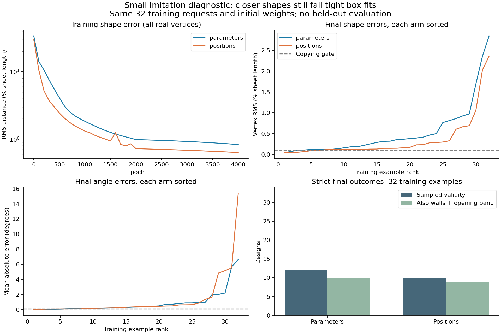

# Results: closer shapes did not produce reliable box fit

Both fixed 4,000-epoch runs finished. Neither met the predeclared copying gate on all 32 training examples. Corrected position imitation reduced average per-example vertex RMS error by **33.3%**, but passed **10/32** versus **12/32** for parameter imitation. Every predicted design used the correct two folds, passed the panel/angle rules and had no prohibited contacts at 721 sampled states. All primary failures were box-fit failures.

This is a training-only, single-seed diagnostic on one selected family. It measures whether this setup copied these examples; it does not measure generalization or establish that this model lacks enough capacity. The losses were still decreasing at the fixed stopping point.

## Frozen setup and complete outcomes

The setup, code and 32-request manifest were committed in `33da2b3` **before training**. See [README](README.md), [config](config.json) and [manifest](manifest.json). Both models have 75,554 parameters, identical initial weights, 32-example full batches and no fit or tighter-fold penalties. Neither the dataset nor historical runs were modified. No validation/test examples were evaluated or used for tuning. Training took 5.85 s (parameters) and 15.11 s (positions) on one CPU thread, excluding geometric evaluation.

| Measurement | Parameter imitation | Corrected position imitation |
| --- | ---: | ---: |
| Correct fold count | 32/32 | 32/32 |
| Contact-free at 721 states | 32/32 | 32/32 |
| Strict 2%-margin box fit and sampled validity | 12/32 | 10/32 |
| Valid, zero floating creases, ≥90% reference opening | 10/32 | 9/32 |
| Zero floating creases, including non-fitting outputs | 23/32 | 24/32 |
| Copying gate: vertex RMS ≤0.1% L **and** angle MAE ≤0.1° | 1/32 | 5/32 |
| Mean per-example vertex RMS, % L | 0.5296 | 0.3532 |
| Median per-example vertex RMS, % L | 0.3160 | 0.1465 |
| Worst per-example vertex RMS, % L | 2.8450 | 2.3596 |
| Mean material crease-position RMS, % L | 0.1578 | 0.1473 |
| Mean absolute fold-angle error, degrees | 0.8912 | 1.3113 |
| Signed fold-angle error: bias / standard deviation, degrees | −0.0522 / 1.7301 | −0.6383 / 3.2538 |
| Largest individual fold-angle error, degrees | 6.7879 | 16.5922 |
| Mean signed smallest-opening error, degrees | −0.0356 | +0.2864 |
| Independent/reference overall decision disagreements | 0/32 | 0/32 |

L means sheet length. Vertex RMS measures distances between corresponding unrotated side-view vertices. Material crease position means prefix sum of panel lengths on the flat sheet. The curve plots the RMS pooled over vertices/examples; the table's mean is the mean of each example's RMS, so these are different aggregations. Fold-angle error is predicted minus reference; opening error uses the opposite angle convention. Floating counts on shapes that do not fit are descriptive, not successful wall-supported designs.

The worst position-loss angle case, `v2-long-0102-b2`, has a reference middle panel of only 5% L. Its predicted angles differ by about 14–17°, yet its vertex RMS is 1.05% L. This illustrates how position loss can tolerate substantial angle error around a short panel. It does not establish that angle supervision should be removed. The largest shape-error case in both arms is `v2-short-0304-b2`.

## Numerical round-trip baseline

| Reference pipeline | Sampled-valid designs | Zero floating creases |
| --- | ---: | ---: |
| Original saved geometry/placement | 32/32 | 32/32 |
| Original geometry, placement searched again | 32/32 | 32/32 |
| Encode/decode float64, saved placement | 32/32 | 32/32 |
| Encode/decode float64, searched placement | 32/32 | 32/32 |
| Encode/decode float32, saved placement | 29/32 | 32/32 |
| Encode/decode float32, searched placement | 32/32 | 32/32 |

Mean float32 round-trip vertex error is only **1.57e−8 L**; nevertheless three stored placements fail strict containment after rounding. Re-searching placement recovers them all. This confirms sensitivity at the box boundary, but rounding alone does not explain the trained models' 20 and 22 failures. Across all five searched groups, the independent metrics and Node reference agree on **160/160** overall decisions. The other three groups use the independent checks at the saved placement.

## Overflow reporting trap and supplementary diagnosis

During analysis, the existing placement bridge was observed returning a non-fitting shape at placement 0° for some failed searches. Its returned overflow is therefore **not a minimum achievable overflow**. The primary immutable prediction files and summary keep exactly what was measured at that returned placement. Their mean raw overflows, 5.180% and 5.552% L, should not be interpreted as the model's best achievable box errors. Floating counts for these failed poses share that limitation.

A separately labeled **post-hoc** diagnostic sweeps 18,000 orientations at 0.01° spacing, translates each bounding-box minimum to zero, and measures the best overflow found without changing panels or angles. It does not replace the primary pass counts, search for wall contact, retrain, or select a new checkpoint. A finite sweep's best overflow is an upper bound on the true minimum, not an infeasibility proof.

| Supplementary best-found overflow | Parameters | Positions |
| --- | ---: | ---: |
| Mean, % L | 0.2282 | 0.2231 |
| Maximum, % L | 1.0430 | 1.9305 |

For example, `v2-short-1404-b2` in the parameter arm returns overflow **49.8% L** at 0°, but the sweep finds **0.0750% L**. This is why failure magnitude needs a defined placement policy as well as a fit flag. Evidence: [placement-diagnostic.json](results/placement-diagnostic.json); generator: [report-memorization.py](../../scripts/report-memorization.py).

## Interpretation and recommended next diagnostic

Measured: masking was wrong; correcting it and removing conflicting penalties improves shape copying relative to the paired parameter-loss run, but precision and strict fit remain poor on training examples. Smaller average geometry error is not sufficient to obtain the right angles or satisfy nearly active box boundaries. This experiment cannot attribute the difference from historical run 4a to masking alone: that run also used different data and penalties.

Recommendation, **not yet run or adopted**: first optimize one independent set of output parameters per training request, with no shared network. That control distinguishes difficulty optimizing the bounded representation/loss from difficulty learning the request-to-design mapping. Then repeat the network diagnostic with the known family encoded directly: `[a, L−2a, a]` and `[θ, θ]`. This family has only two independent continuous values; the current generic head emits 22 shape values and learns symmetry indirectly. Compare on the same 32 requests with a new frozen optimization budget. Keep both angle and position precision visible. Do not infer from one seed and 4,000 epochs that a larger network is necessary, or jump to a full-scale retraining result.

Validation: 12 Python unit tests passed, including analytical shapes, all fold counts against the independent FOLD exporter, padding/gradient regression, finite-difference gradients, round-trip boundaries, and placement/contact metrics. `npm test` passed all 7 test files. `src/packing.js` was invoked through the existing bridge but its source was not read.

These are zero-thickness, sampled checks. They do not prove continuous collision-free motion, ranking optimality, generalization, or physical usefulness. No FOLD export or evaluator result certifies a design. All jobs are finished.

Raw evidence: [summary](results/summary.json), [environment](results/environment.json), both histories, both final checkpoints, shared initial checkpoint, every prediction and every baseline are retained in [results](results/).
