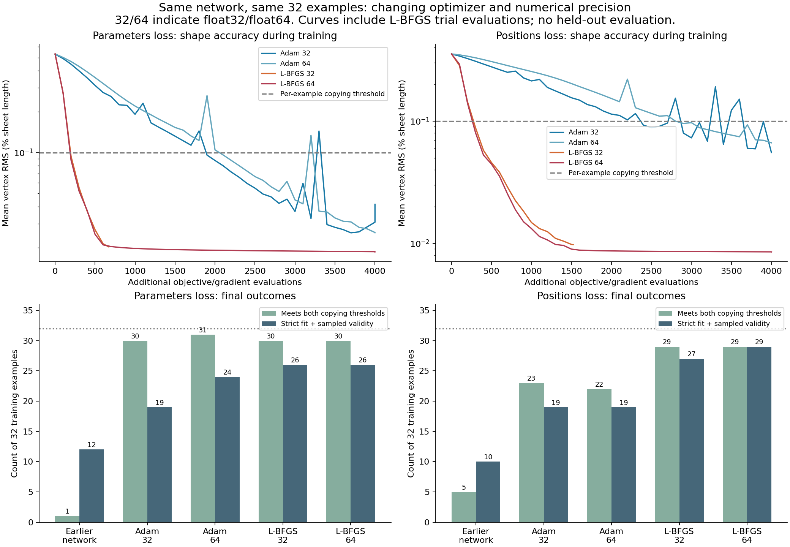

# The same network learns much more accurately with better optimization

The strongest observed sampled-validity result improved from **10/32 to 29/32** on the same 32 training requests, without changing network size, output format, geometry rules or loss. This used position imitation with L-BFGS in float64. Mean vertex error fell **41.5×**, from 0.3532% to 0.00852% of sheet length. Parameter imitation improved from **12/32 to 26/32**, with mean vertex error reduced up to **28.5×**.

More training with Adam also helped substantially. The earlier poor result was therefore not evidence that this architecture cannot learn these examples. Nevertheless **no arm met the all-32 copying gate or all-32 strict validity goal**. These are results on known training examples, not new boxes.

## Frozen experiment and primary outcomes

Protocol, config, runner and initial tests were committed in **`520ba26` before training**. See [protocol](README.md) and [config](config.json). For each existing loss, four arms start from its saved 4,000-epoch memorization-v1 checkpoint: Adam/L-BFGS × float32/float64. Architecture is the same 75,554-parameter network. The two losses have different prior checkpoints, so cross-loss results are descriptive, not a controlled loss-only comparison.

Adam restarts from those weights with fresh moments, 4,000 further steps at 0.0001. L-BFGS uses a 4,000 objective/gradient-evaluation ceiling, up to 4,000 iterations, fixed tight stopping tolerances and a line search. All final iterates are reported; no geometry-selected checkpoint or retry. No held-out data, new initialization, architecture change, penalty or shape correction. The manifest and starting checkpoints are hash-pinned.

The copying gate requires **both** vertex RMS ≤0.1% L and angle MAE ≤0.1° on every example. Sampled validity is separate and includes the 2% box margin after the standard placement search. L means sheet length.

| Loss | Training | Copying gate /32 | Independent sampled validity /32 | Assessment bridge /32 | Mean vertex RMS, % L | Angle MAE, degrees |
| --- | --- | ---: | ---: | ---: | ---: | ---: |
| Parameters | Earlier baseline | 1 | 12 | 12 | 0.52957 | 0.89122 |
| Parameters | Adam float32 | 30 | 19 | 19 | 0.04160 | 0.03639 |
| Parameters | Adam float64 | 31 | 24 | 24 | 0.02575 | 0.02041 |
| Parameters | L-BFGS float32 | 30 | 26 | 26 | 0.02025 | 0.01819 |
| Parameters | L-BFGS float64 | 30 | 26 | 26 | 0.01859 | 0.01666 |
| Positions | Earlier baseline | 5 | 10 | 10 | 0.35323 | 1.31131 |
| Positions | Adam float32 | 23 | 19 | **18** | 0.05529 | 0.19999 |
| Positions | Adam float64 | 22 | 19 | 19 | 0.06634 | 0.23057 |
| Positions | L-BFGS float32 | 29 | 27 | 27 | 0.00978 | 0.02798 |
| Positions | L-BFGS float64 | 29 | 29 | 29 | 0.00852 | 0.02812 |

All valid new answers also have zero floating creases and opening at least 90% of reference. Every new predicted answer, including casts and the inference controls below, has the correct two folds and passes panel/angle rules and 721-state contact checks. Failures are box fit. No all-example precision or fit goal was achieved. The 29 passing and 29 precisely copied examples in the strongest run are not exactly the same subset.

At fixed float32 precision, L-BFGS improves validity over restarted Adam from 19 to 26 (parameters) and 19 to 27 (positions, independent count). Thus the optimizer benefit does not require float64. Higher precision alone is not a consistent remedy: position-loss Adam float64 has worse mean copying errors than float32. The normalization finding below also complicates attributing float32/64 training differences solely to arithmetic precision.

## Optimization did not establish a numerical optimum

| Loss / optimizer / precision | Objective evaluations | Iterations | Optimization seconds | Final maximum absolute gradient |
| --- | ---: | ---: | ---: | ---: |
| Parameters / Adam / 32 | 4,000 | 4,000 | 6.26 | 3.25e−5 |
| Parameters / Adam / 64 | 4,000 | 4,000 | 7.31 | 5.91e−6 |
| Parameters / L-BFGS / 32 | 671 | 595 | 4.78 | 6.72e−7 |
| Parameters / L-BFGS / 64 | 4,001 | 2,272 | 26.45 | 2.36e−7 |
| Positions / Adam / 32 | 4,000 | 4,000 | 12.27 | 4.80e−5 |
| Positions / Adam / 64 | 4,000 | 4,000 | 13.39 | 8.20e−5 |
| Positions / L-BFGS / 32 | 1,522 | 1,296 | 13.44 | 2.46e−6 |
| Positions / L-BFGS / 64 | 4,001 | 2,628 | 38.72 | 1.28e−6 |

Times exclude geometry evaluation. Float32 L-BFGS returned before its budget; neither met the requested gradient tolerance of 1e−12. Both float64 L-BFGS runs finished a line search one evaluation past the nominal 4,000 limit. Their curves flatten substantially, but **do not describe them as proven converged or globally optimal**. Equal evaluation ceilings do not mean equal work or runtime. Histories include trial points inside L-BFGS line searches, not only accepted iterates.

## Casting revealed an input-normalization problem

The predeclared deployment check casts each trained float64 network's weights and normalization buffers to float32, then reruns inference with float32 inputs. This initially lost multiple fits:

| Float64-trained network | Native float64 valid | Ordinary float32 conversion valid | Matched-normalized-input float32 control valid |
| --- | ---: | ---: | ---: |
| Parameters / Adam | 24 | 22 | **24** |
| Parameters / L-BFGS | 26 | 22 | **26** |
| Positions / Adam | 19 | 16 | **19** |
| Positions / L-BFGS | 29 | 19 | **29** |

The last column is an explicitly **post-hoc inference-only control**, kept in [precision-audit](precision-audit/). It does not retrain, replace primary results or change geometric rules. All ordinary cast failures remain in the main results.

The network first normalizes each input: `(value − mean) / standard deviation`. This puts inputs on comparable scales. Every request in this diagnostic has budget 2, represented as `2/11`, so this input is constant. Its stored standard deviation is clamped to roughly **1e−6**.

- Saved float32 budget value and mean: **0.1818181872367859**.
- Fresh float64 budget input: **0.18181818181818182**.
- The normalized budget is **0 in float32**, but **−0.005418604 in float64**.

A tiny rounding difference is magnified by division by an extremely small number. The other two normalized input coordinates change by less than 2e−7. Switching numerical precision therefore changes the effective constant input appreciably, even though the user still requests budget 2.

The control computes the float64 network's normalized input coordinates, rounds those coordinates to float32, and feeds them to the same float32 weights/layers without normalizing a second time. **Every native float64 pass count is recovered**, including 29/32 for position L-BFGS. This retains high-precision preprocessing for the control; it is not proof that the unchanged fully-float32 input pipeline works.

For position L-BFGS, changing only input encoding while keeping float64 network arithmetic changes an active fold angle by up to **0.0511°**. With matched normalized inputs and float32 weights/arithmetic, the largest active-angle difference is only **0.0000246°**. This strongly supports input preprocessing as the cause of the large cast degradation. It does not prove that rounding can never matter near a wall.

This instability is particularly exposed by the fixed-budget subset; the full training dataset varies budgets, so do not extrapolate this exact failure magnitude to it. A general remedy should handle constant features safely and define consistent preprocessing. No family-specific shape is needed. Existing training/normalization code was not changed mid-experiment; correction and rerun would require a new recorded version.

## One boundary disagreement, fully retained

There is **one** independent/bridge disagreement among the **384 primary and cast predictions**, and zero in the **128 matched-input controls**. It is `v2-short-0297-b2` under position-loss Adam float32.

The measured overflow is **6.7257e−10 L**, below the independent check's numerical tolerance. The bridge in `scripts/assess-designs.js` rejects *any positive* placement overflow before calling the underlying assessment. Calling that assessment directly on the unchanged saved design returns `passes: true`, agrees with the independent check, and reports 721 states.

Thus the independent count is 19 while the frozen bridge count is 18 in that one arm. No count was silently rewritten, and the bridge/solver source was not modified. The underlying `src/packing.js` was invoked but its source was not read. Full reproduction is in [network_precision_audit.py](../../learning/network_precision_audit.py), with [all disagreement evidence](precision-audit/decision-disagreements.json).

## Remaining failures and interpretation

The strongest observed validity arm (position L-BFGS float64) fails three requests:

| Request | Best overflow found on the 0.01° sweep, % L |
| --- | ---: |
| `v2-short-0022-b2` | 0.01583 |
| `v2-short-1261-b2` | 0.07031 |
| `v2-long-0102-b2` | 0.03606 |

These are small misses, but they still fail the unchanged task. The grid values are upper bounds on minimum achievable overflow, not infeasibility proofs. Previously observed finite-grid misses of known fitting poses still apply. For one parameter-loss failure, returned-pose overflow is 31.4% L while grid-best overflow is only 0.00325% L; the raw fallback pose must not be mistaken for the best placement.

**Measured:** the same architecture benefits substantially from continued training and optimizer changes. The original 4,000-epoch failure was not enough to justify a larger network. Matching normalized inputs restores the float64-trained networks' validity counts in the float32 inference control.

**Still unknown:** performance on new boxes; whether corrected consistent preprocessing changes the training comparison; whether different optimization settings reach all 32; whether the remaining errors arise from optimization, parameterization near boundaries, or shared-network limitations. One seed and one subset cannot answer those questions. Copying thresholds and strict validity measure different things.

**Recommended next, not run:** correct constant-feature preprocessing and align the bridge's numerical fit policy with the underlying evaluator, with regression tests and fresh versioned evidence. Then repeat the affected controls before selecting a training recipe or scaling. Keep architecture and geometric rules unchanged. Family-specific outputs and held-out testing were not performed.

## Verification and evidence

All **19 Python tests** passed: existing geometry/gradient/independent-export checks, isolated optimizer arms, exact checkpoint/normalization preservation, evaluation accounting and matched-input forward parity. No solver/geometry implementation changed, so Node tests were not rerun. The plot was inspected. Input and dataset hashes were checked unchanged.

[Primary results](results/summary.json), [environment](results/environment.json), histories, checkpoints, all designs, saved-pose diagnostics and grid overflows are retained in [results](results/). [Post-hoc normalization audit](precision-audit/summary.json) is separate. Nothing overwrites historical results. All jobs are finished.

These are zero-thickness sampled checks, not proof of continuous collision freedom, ranking optimality, generalization or physical certification.
