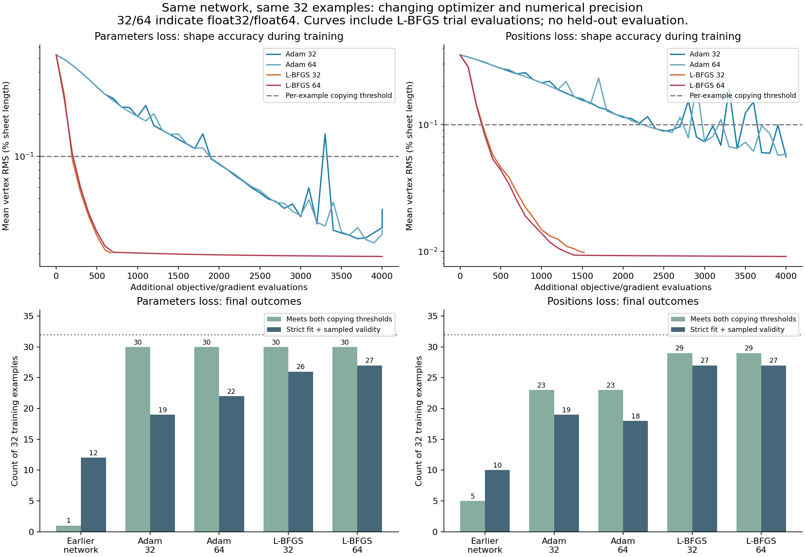

# Corrected pipeline confirmation

Both requested steps are complete. All 384 primary/cast decisions agree between the corrected assessment bridge and independent checker. The current strongest sampled-validity result is **27/32**, preserved when both float64 L-BFGS networks are converted to float32. The earlier position-loss 29/32 belonged to the previous preprocessing version; it is not the corrected result.

Protocol frozen in 5f3ba27 before execution. Same 32 training requests, starting checkpoints, eight optimizer/precision arms and four casts as v1. No held-out evaluation. All final outcomes retained.

Two fixes: Model uses effective scale 1 for stored scales at/below the historical 1e-6 floor, preventing amplification of rounding in constant inputs. The assessment bridge always delegates fit acceptance to the underlying evaluator after placement, retaining its numerical tolerance. Nonconstant scales are preserved; very small scales also receive this conservative treatment. Historical checkpoint behavior can change and old evidence is untouched.

| Arm | Copying target /32 | Sampled valid /32 | Disagreements |
| --- | ---: | ---: | ---: |
| parameters-adam-float32 | 30 | 19 | 0 |
| parameters-adam-float64 | 30 | 22 | 0 |
| parameters-adam-float64-cast32 | 30 | 23 | 0 |
| parameters-lbfgs-float32 | 30 | 26 | 0 |
| parameters-lbfgs-float64 | 30 | 27 | 0 |
| parameters-lbfgs-float64-cast32 | 30 | 27 | 0 |
| positions-adam-float32 | 23 | 19 | 0 |
| positions-adam-float64 | 23 | 18 | 0 |
| positions-adam-float64-cast32 | 23 | 18 | 0 |
| positions-lbfgs-float32 | 29 | 27 | 0 |
| positions-lbfgs-float64 | 29 | 27 | 0 |
| positions-lbfgs-float64-cast32 | 29 | 27 | 0 |

The copying target requires both vertex RMS <=0.1% sheet length and angle MAE <=0.1 degrees. Validity additionally requires strict box containment with the 2% gap and 721-state contact checks. All scores use the final iterate, with no retry or best-checkpoint selection. Casts recompute inference with float32 weights and inputs. Small remaining rounding differences can still change nearly tight fits; fixing normalization does not guarantee identical trajectories or decisions.

Validation: 21 Python tests passed, including precision stability, unchanged nonconstant scaling, boundary acceptance and rejection of genuine oversize. npm test passed all seven test files. One historical parity test initially failed because it expected the old normalization; it was updated to assert corrected preprocessing parity. That test-only update did not change the frozen training code.

Results establish sampled validity only, not continuous collision freedom, ranking optimality or generalization. No larger dataset training performed. All jobs finished.

[Raw summary](results/summary.json) contains precision, pose, overflow, optimizer convergence and timing measurements. Checkpoints and every prediction are retained alongside it.

## What the confirmation means

At float32, L-BFGS reaches 26/32 parameter-loss and 27/32 position-loss passes, compared with 19/32 for restarted Adam in both arms. This supports the earlier optimizer finding with the corrected measurement pipeline. Float64 L-BFGS reaches 27/32 for both losses; there is no clear practical validity advantage to higher precision in this small comparison. These are single-seed outcomes with different optimizer work per update, not a general optimizer ranking.

All 384 outputs have the correct two folds, meet panel/angle rules, and pass 721-state contact checks. All valid answers also have zero floating creases and opening at least 90% of the reference. Failures are box fit. No arm meets all-32 copying or validity goals. Float32 L-BFGS returns before the evaluation ceiling; float64 uses 4,000 evaluations. No L-BFGS arm meets the requested 1e-12 gradient tolerance, so numerical convergence is not established.

[Cast stability measurements](results/cast-stability.json) show maximum vertex RMS change below 4e-7 sheet lengths for each of the four conversions. One parameter-loss Adam answer changes from fail to pass (22→23); both L-BFGS counts remain 27. Small rounding effects near a wall remain possible, while the previous large constant-input amplification has been removed.

The previous 0.0054 normalized-budget shift is now about 5.4e-9, because the historical floor uses scale 1 instead of 1e-6. Real feature changes are still passed through; they are not ignored. Existing checkpoints can be loaded without adding state-dictionary keys, but forward behavior changes for floor-scaled features. Reproducing historical experiments requires their recorded source commit. This is a general numerical fix, not a family-specific design constraint.

The regression suite includes the exact prior bridge disagreement: it now passes according to the underlying evaluator; an obviously oversized design still fails. The solver source was not read or modified. The evaluator's numerical tolerance is unchanged; only the bridge's conflicting prefilter was removed.

The input manifest, source dataset and starting checkpoint hashes were verified unchanged. The only update after the frozen training-code commit was a historical parity test's expectation; no training implementation was changed during the run.

Next discussion: choose a bounded full-training/validation comparison using the corrected pipeline. Larger training, held-out evaluation, family-specific representations and architecture changes were not performed in these steps.
