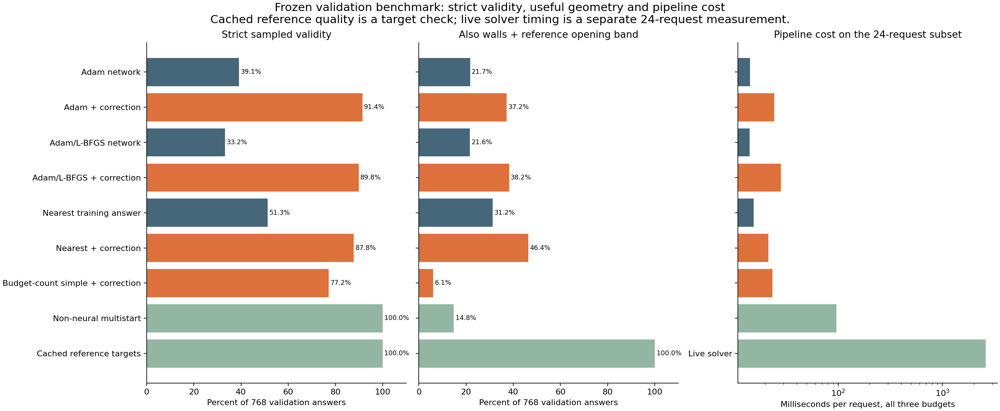

# Step 4 validation benchmark

**There is no overall winner on validity, design quality and cost.** Adam + correction is the strongest neural validity recipe at **91.45%**, while nearest-neighbour + correction achieves higher wall/opening quality (**46.35%**) at **87.76%** validity. A non-neural multistart fits all 768 known-solvable answers but meets the wall/opening criterion on only **14.84%**. L-BFGS training refinement does not improve validation validity, despite its better training result.

Frozen before inference; no retraining, seed selection, adaptive search or final-test evaluation. Protocol and source commit are recorded in results/environment.json. Primary set: 768 answers from 256 reference-found validation requests. Related budgets and repeated seed predictions are not independent requests.

## Every method and seed

| Method | Valid /768 | Valid + walls + opening /768 | Correct count | Precision gate | Mean pipeline ms/answer | Mean / max score calls |
| --- | ---: | ---: | ---: | ---: | ---: | ---: |
| seed-17-adam-raw | 303 (39.45%) | 172 (22.40%) | 744 | 96 | 4.668 | 0.00 / 0 |
| seed-17-adam-repair | 700 (91.15%) | 289 (37.63%) | 744 | 96 | 8.177 | 28.17 / 360 |
| seed-17-lbfgs-raw | 234 (30.47%) | 159 (20.70%) | 747 | 96 | 4.399 | 0.00 / 0 |
| seed-17-lbfgs-repair | 690 (89.84%) | 282 (36.72%) | 747 | 96 | 9.182 | 39.45 / 400 |
| seed-29-adam-raw | 289 (37.63%) | 161 (20.96%) | 751 | 96 | 4.930 | 0.00 / 0 |
| seed-29-adam-repair | 706 (91.93%) | 290 (37.76%) | 751 | 97 | 8.361 | 28.76 / 400 |
| seed-29-lbfgs-raw | 264 (34.38%) | 171 (22.27%) | 748 | 96 | 5.043 | 0.00 / 0 |
| seed-29-lbfgs-repair | 684 (89.06%) | 296 (38.54%) | 748 | 96 | 10.293 | 34.27 / 400 |
| seed-43-adam-raw | 309 (40.23%) | 168 (21.88%) | 753 | 96 | 4.898 | 0.00 / 0 |
| seed-43-adam-repair | 701 (91.28%) | 278 (36.20%) | 753 | 96 | 9.245 | 28.77 / 400 |
| seed-43-lbfgs-raw | 266 (34.64%) | 168 (21.88%) | 746 | 96 | 5.066 | 0.00 / 0 |
| seed-43-lbfgs-repair | 696 (90.62%) | 303 (39.45%) | 746 | 96 | 10.066 | 29.80 / 385 |
| nearest-raw | 394 (51.30%) | 240 (31.25%) | 730 | 101 | 5.136 | 0.00 / 0 |
| nearest-repair | 674 (87.76%) | 356 (46.35%) | 730 | 102 | 8.499 | 20.09 / 400 |
| simple-repair | 593 (77.21%) | 47 (6.12%) | 498 | 32 | 9.393 | 52.15 / 400 |
| simple-multistart | 768 (100.00%) | 114 (14.84%) | 493 | 96 | 36.597 | 78.79 / 344 |
| reference-cached | 768 (100.00%) | 768 (100.00%) | 768 | 768 | cached assessment only | 0.00 / 0 |

## Recipe means and deterministic baselines

| Method | Mean validity | Seed range | Mean quality | Mean pipeline ms/answer |
| --- | ---: | ---: | ---: | ---: |
| Adam network | 39.11% | 37.63–40.23% | 21.74% | 4.832 |
| Adam + correction | 91.45% | 91.15–91.93% | 37.20% | 8.594 |
| Adam/L-BFGS network | 33.16% | 30.47–34.64% | 21.61% | 4.836 |
| Adam/L-BFGS + correction | 89.84% | 89.06–90.62% | 38.24% | 9.847 |
| Nearest training answer | 51.30% | 51.30–51.30% | 31.25% | 5.136 |
| Nearest + correction | 87.76% | 87.76–87.76% | 46.35% | 8.499 |
| Budget-count simple + correction | 77.21% | 77.21–77.21% | 6.12% | 9.393 |
| Non-neural multistart | 100.00% | 100.00–100.00% | 14.84% | 36.597 |
| Cached reference targets | 100.00% | 100.00–100.00% | 100.00% | not solver latency |

## Live reference subset

Fresh solver calls on 24 preselected requests generated 72 budget answers, with 72 passing. Mean cost: **2601.85 ms per request for all requested budgets together**. Cached reference rechecking above is not solver cost. This is an unrestricted solver, unlike the limited 400-score methods. It does not prove ranking optimality.

| Method | Subset valid answers | Mean ms/request, all budgets |
| --- | ---: | ---: |
| Adam network | 37.00/72 | 14.308 |
| Adam + correction | 68.67/72 | 24.456 |
| Adam/L-BFGS network | 29.00/72 | 14.204 |
| Adam/L-BFGS + correction | 64.33/72 | 28.191 |
| Nearest training answer | 48.00/72 | 15.531 |
| Nearest + correction | 65.00/72 | 21.459 |
| Budget-count simple + correction | 58.00/72 | 23.456 |
| Non-neural multistart | 72.00/72 | 95.836 |

## Interpretation boundaries

Quality means valid, zero floating creases and smallest opening at least 90% of the saved reference. This is a proxy based on the chosen reference, not a proof of optimal ranking or aesthetic usefulness. Alternate good designs may differ from reference panels, angles or count. The strict copying gate is diagnostic only.

Neural inference/decoding and nearest lookup are resident, batch-amortized preparation costs. Native query pipeline time includes search, placement and final checking. Means and percentiles exclude model/index loading, Node process startup, IPC and diagnostic tolerance sweeps. Batch wall times including IPC are retained separately. Cold single-query or production deployment latency has not been measured. The random 24-request solver subset is not a complete solver runtime distribution; no cross-machine comparison is made.

Multistart tries every count with equal panels at 150/180 degrees under one shared score budget. These initial assessments and all placements count toward measured pipeline time even when they use no objective score calls. Score counts alone do not equal computation. Neural correction keeps predicted count fixed; nearest lookup uses only training labels with the same budget. A valid flat stack may have zero opening, so validity by itself is insufficient.

All tolerance diagnostics are separate, use both width-inclusive placement objectives, and do not alter strict acceptance. Finite search gives upper bounds, not infeasibility proofs. Correction uses coarse 31-state contact screening and final 721-state assessment, with exact score-call cap. No continuous collision guarantee, finite-thickness, actuation, layer-order or manufacturing claim.

Validation has informed earlier development too; this is a development benchmark rather than a pristine final test. Results cannot be converted into a final-test claim. All seeds/methods and failures are retained, with no selected winner or newly trained checkpoint.

## Evidence

Checkpoints are the original step-3 final checkpoints, pinned by hash in config. Inputs and source hashes, manifests, per-answer predictions/assessments/edits/times, tolerance curves, nearest training IDs, fresh solver records and software environment are in [results](results/). The final test split is not retained or evaluated. No jobs remain active.

## What changed from the training conclusion

Raw Adam training validity averaged 43.13%; validation is 39.11%. Raw Adam/L-BFGS training averaged 45.46%, but validation falls to 33.16%, below Adam in all three paired seeds. More exact fitting of training examples did not generalize under this recipe. This is consistent with overfitting or a less transferable fitted mapping, not proof of one cause or a general claim against L-BFGS.

Do not directly attribute the earlier legacy-correction training result (95.35%) versus current corrected-correction validation (89.84% for L-BFGS) entirely to generalization: correction policy changed between those experiments (strict score cap, initial canonical acceptance/contact handling). The raw network comparison uses the same saved models and standard assessment and supports the above conclusion independently.

Retrieval alone (51.30% validity, 31.25% wall/opening quality) outperforms either raw network on these metrics at similar pipeline cost. Neural initialization becomes useful for maximizing limited-search validity: Adam + correction reaches 91.45% versus nearest + correction 87.76%. But retrieval + correction retains better quality (46.35% versus 37.20%). Neither result establishes that a neural model is required for this task. Three seeds and related budget answers are insufficient for a general statistical-superiority claim.

Non-neural multistart gets 100% validity with its shared cap, including ideal 180-degree flat stacks. Their permissibility is part of the original zero-thickness rules; poor opening quality (14.84% qualifying) demonstrates why validity alone is inadequate. This baseline costs about 36.60 ms/answer versus 8.59 ms/answer for Adam+correction and 8.50 for nearest+correction under the stated resident/batched timing. It is not a globally optimized conventional solver.

Fresh reference solver results on the fixed 24-request subset: **72/72 valid and 72/72 also satisfying wall/opening band**, measured against saved targets. Mean reference cost is 2,601.85 ms/request for all three budgets. On those exact requests, mean Adam+correction costs about 24.46 ms/request for all three answers, with mean 68.67/72 valid across seeds; nearest+correction costs 21.46 ms/request with 65/72 valid. The speed difference is accompanied by failures and quality differences. Cached-reference rechecking is never treated as solver latency. No global optimality or runtime outside this small subset is established.

The primary benchmark excludes **10 analytically width-infeasible and 58 solver-not-found validation requests**. Unresolved status is not proof of infeasibility. All validation statuses are in the manifest; this experiment's 100% baseline success refers only to the 256 reference-found requests, not all possible boxes or all 324 validation requests.

## Engineering fixes and verification

The correction now counts the initial score and every trial against one exact cap, checks limits inside the coordinate loop, accepts existing valid designs through the canonical evaluator, and finally checks 721 states. Invalid fit/contact designs may be searched. The multistart shares its cap across all counts and starts. Canonical numerical tolerance remains unchanged. The legacy overflow heuristic and coarse search screen remain limitations; no search failure proves infeasibility.

The corrected tolerance tool includes width and independently minimizes sheet-relative and usable-box-relative overshoot. Tests cover a width-infeasible fixture, an asymmetric case where the relative optimum materially differs, exact score caps at 0/1/2/17, canonical boundary acceptance, nonmutation and shared multistart budgets. Curves are saved separately and do not replace strict acceptance.

All **26 Python tests** passed, the Node suite passed all **8 files**, and the extended benchmark-policy tests passed after adding multistart/relative-objective coverage. All **13,056** primary answer records match manifest IDs, remain within requested budgets and cap 400, and passing records have 721-state fit/contact checks. Correction preserved every raw neural success. Input/code/checkpoint hashes are unchanged from frozen settings; nearest IDs were verified training-only. Plot inspected; no raw results or failed outputs overwritten. Solver source was not read or edited. All jobs finished.

## Recommendation for step 5

Choose a quality/speed policy before final testing rather than increasing model size on the strength of training accuracy. Keep the reference solver as the high-quality baseline; consider retrieval+correction for a faster quality-oriented proposal and Adam+correction for a faster validity-oriented proposal. Neither is yet a reliable replacement for the reference solver. A concrete proposal-selection/fallback policy would need to use observable criteria (fit, floating creases, opening), not the unknown reference opening band at deployment, and be frozen and validated as a separate method before final test. Do not select the best seed after seeing these results. No final recipe or final-test evaluation is performed here.
